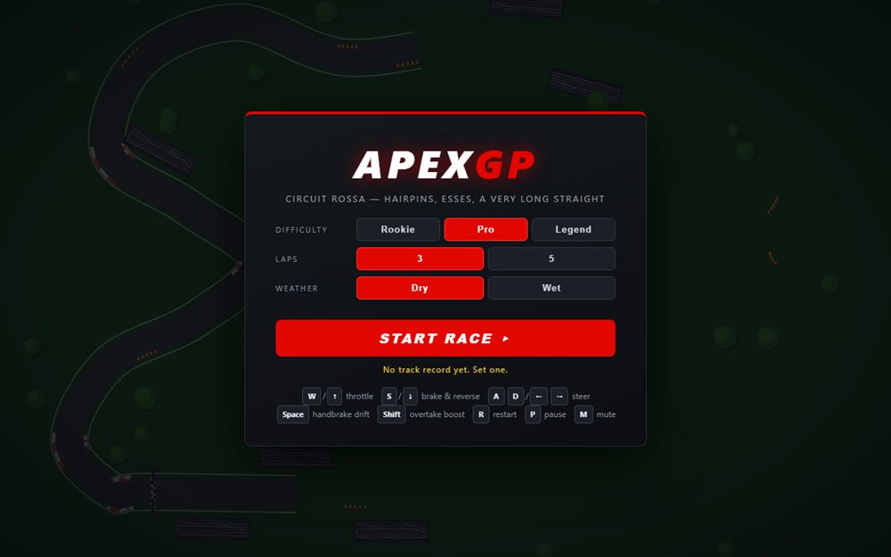

# APEX GP - Formula Racer

A canvas Formula-style racer: throttle, steer, and keep the lap time down.

**[Open the live site](https://ajeet-iitk.github.io/F1.1/)**

## What it does

A small top-down racer built around a canvas track. Throttle and steering are keyboard driven, the camera follows the car, and the best lap lives in `localStorage`. Engine and tyre sound are synthesised with the Web Audio API rather than loaded from files.

## Features

- Canvas track rendered with `requestAnimationFrame`
- Keyboard throttle and steering
- Procedural audio through `AudioContext`
- Best lap persisted in `localStorage`

## Run locally

Open `index.html`, or race the hosted build:

<https://ajeet-iitk.github.io/F1.1/>

## Files

| File | Purpose |
| --- | --- |
| `index.html` | Landing page |
| `apex-gp.html` | The game |

---

Part of [my collection of small projects](https://github.com/Ajeet-iitk).
